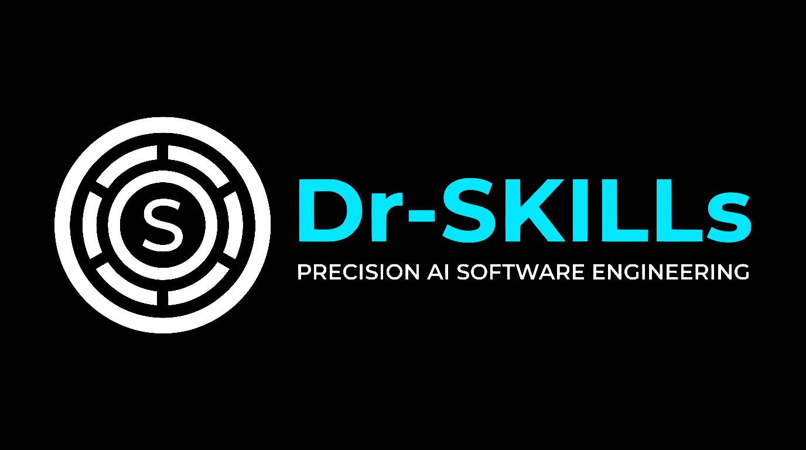

# Dr-SKILLs

<p align="center">
  
</p>

<p align="center">
  <strong>Dr-SKILLs: The Autonomous AI Developer Agent Skills &amp; MCP Ecosystem</strong><br/>
  <em>Prescribing modular skills, surgical refactoring, and enterprise governance for Google Antigravity, Claude Code, Cursor, and Codex.</em>
</p>

<p align="center">
  <a href="#-included"></a>
  <a href="#-namespaced-plugins"></a>
  <a href="#-real-time-mcp-integrations"></a>
  <a href="SECURITY.md"></a>
  <a href="#-security-hardening--governance"></a>
  <a href="LICENSE"></a>
</p>

<p align="center">
  <sub>🛡️ <strong>Watermark:</strong> Curated &amp; Maintained by <strong>Aman Pal</strong> • Verified Build v2.1.0</sub>
</p>

---

## ⚡ Quick Start

Install Dr-SKILLs across all supported AI coding agents with a single command:

```bash
npx -y dr-skills install all
```

### 🧭 Which agent do you use?

| Your AI Agent / Platform | One-Line Install Command | Verification Step | Installed Target Paths |
| :--- | :--- | :--- | :--- |
| 🩺 **All Agents (Recommended)** | `npx -y dr-skills install all` | `npx -y dr-skills doctor` | `~/.gemini`, `~/.agent`, `~/.codex` |
| ⚡ **Google Antigravity & AGY CLI** | `npx -y dr-skills install antigravity` | `npx -y dr-skills doctor` | `~/.gemini/config/skills/` & `rules/` |
| 🤖 **Claude Code** | `npx -y dr-skills install claude` | `npx -y dr-skills doctor` | `~/.agent/skills/` & `rules/` |
| 🖱️ **Cursor** | `npx -y dr-skills install cursor` | `npx -y dr-skills doctor` | `~/.agent/skills/` & `rules/` |
| 🧠 **OpenAI Codex CLI** | `npx -y dr-skills install codex` | `npx -y dr-skills doctor` | `~/.codex/skills/` |
| 📁 **Local Project (Windsurf / Trae / Copilot)** | `npx -y dr-skills install ./my-project` | `npx -y dr-skills doctor` | `<project>/.agent/skills/` & `rules/` |

> 💡 *PowerShell Alternative:* Windows users can also run `.\install-skills.ps1 store` or `.\install-skills.bat`.

---

## 🩺 System Diagnostics & Health Verification

Run comprehensive health checks on your agent stores, manifest integrity, MCP configurations, and secret scans:

```bash
npx -y dr-skills doctor
```

## 🔄 Safe Uninstall & Rollback

Uninstall safely removes only ecosystem-declared skills and plugins, leaving custom user code strictly untouched:

```bash
# Uninstall from specific agent or globally
npx -y dr-skills uninstall antigravity
npx -y dr-skills uninstall all

# Or safely restore a previous state from automated timestamped backup
npx -y dr-skills rollback
```

---

### Key Documentation Links

- 📖 [**ECOSYSTEM.md**](ECOSYSTEM.md) — Complete catalog and technical specifications for all skills, plugins, and MCP servers.
- 🔒 [**SECURITY.md**](SECURITY.md) — Security policy, path sanitization invariants, and vulnerability reporting.
- 🛡️ [**DEFEND.md**](DEFEND.md) — Defend What You Ship: whiteboard defense checklists, session handover, and pre-ship quality gates.
- 🤝 [**CONTRIBUTING.md**](CONTRIBUTING.md) — Contributor guide for local development, adding skills, and testing.

---

## 🛠️ Local Repository Development

If you are developing or contributing to the ecosystem locally:

```bash
npm install
npm run doctor
npm test
```

---

## ✨ Key Features & Capabilities

<table>
  <tr>
    <td width="50%">
      <h3>🧠 Zero-Hallucination Docs</h3>
      <p>Integrated <strong>Context7 MCP</strong> retrieves live, version-specific library docs and verified API signatures in real-time, eliminating hallucinated methods in modern frameworks.</p>
    </td>
    <td width="50%">
      <h3>🛡️ Defend What You Ship</h3>
      <p>Strict whiteboard defense governance: <strong>Dual-Speed Lanes</strong> (PoC vs Customer-Facing), session handovers, zero-vibes empirical verification, and <code>docs/</code> decision ledgers.</p>
    </td>
  </tr>
  <tr>
    <td width="50%">
      <h3>✂️ Ponytail Radical Simplicity</h3>
      <p>Anti-overengineering doctrine enforcing standard library first, YAGNI, zero speculative abstractions, minimal PR diffs, and deliberate debt ledger tracking.</p>
    </td>
    <td width="50%">
      <h3>⚡ GSD Autonomous Waves</h3>
      <p><strong>Get Shit Done (GSD)</strong> methodology with strict Spec Locks, dependency-ordered wave execution, context hygiene state dumps, and automatic git checkpointing.</p>
    </td>
  </tr>
  <tr>
    <td width="50%">
      <h3>🎨 UI/UX Pro Max & Stitch</h3>
      <p>AI design system integrating <strong>Google Stitch MCP</strong>, <strong>shadcn</strong>, and <strong>21st.dev</strong> with senior UX psychology laws (Fitts, Hick, Miller) and fluid motion.</p>
    </td>
    <td width="50%">
      <h3>🔒 Hardened Security Architecture</h3>
      <p>Zero hardcoded keys, automated secret scanner, path traversal blockers, sandboxed agent permissions, and CodeRabbit AI quality review gates.</p>
    </td>
  </tr>
</table>

---

## 🚦 Skill Routing Hierarchy

When requests arrive, the agent matches user intent against this deterministic routing ladder to minimize token overhead:

```text
User Request
 │
 ├── 🎨 UI / Design / Mockup         ──► designing-with-stitch + ui-ux-pro-max + brand-identity
 ├── 🕸️ Codebase Graph / Architecture──► graphify + archify + gsd-codebase-mapper
 ├── 📚 Library Docs / API Reference ──► context7-mcp
 ├── 🚨 Error Tracking / APM / Sentry──► integrating-sentry + error-handling-patterns
 ├── 🛡️ Security / Whiteboard Defense──► defend-what-you-ship + security-audit + owasp-security
 ├── 🛠️ Backend / API / Database     ──► building-backend + integrating-sentry
 ├── ✂️ Anti-Bloat / Minimal Code    ──► ponytail
 ├── 🚀 Full Autonomous Delivery     ──► unified-build-pipeline (GSD + Ralph + CodeRabbit)
 ├── 👥 Multi-Agent Squad            ──► antigravity-agents
 ├── 📋 PRD / Sprint / Roadmap       ──► project-management + ralph-prd
 ├── 📈 Launch / SEO / GTM           ──► gtm-strategy + seo-optimizer
 └── 💡 Authoring a New Skill        ──► creating-skills
```

---

## 🧩 Skill Catalog (54 Skills)

### 🛠️ Backend, APIs & Infrastructure

| Skill                         | Directory                                                                          | Core Capabilities                                                                                               |
| :---------------------------- | :--------------------------------------------------------------------------------- | :-------------------------------------------------------------------------------------------------------------- |
| **`building-backend`**        | [`.agent/skills/building-backend/`](.agent/skills/building-backend/)               | Production REST, GraphQL, gRPC APIs, database migrations, Redis caching, worker queues, and microservices.      |
| **`integrating-sentry`**      | [`.agent/skills/integrating-sentry/`](.agent/skills/integrating-sentry/)           | Complete Sentry APM across Python (`sentry-sdk`), Next.js (`@sentry/nextjs`), and Node.js (`@sentry/node`).     |
| **`managing-firebase`**       | [`.agent/skills/managing-firebase/`](.agent/skills/managing-firebase/)             | Firebase project setup, Firestore security rules, Cloud Functions, and Firebase MCP integrations.               |
| **`error-handling-patterns`** | [`.agent/skills/error-handling-patterns/`](.agent/skills/error-handling-patterns/) | Fault-tolerant error propagation, Result types, structured logging, circuit breakers, and graceful degradation. |
| **`using-codex-cli`**         | [`.agent/skills/using-codex-cli/`](.agent/skills/using-codex-cli/)                 | Headless execution, sandboxed non-interactive runs, and review pipelines with OpenAI Codex CLI.                 |

### 🎨 Frontend, UI/UX & Design Systems

| Skill                       | Directory                                                                      | Core Capabilities                                                                                                   |
| :-------------------------- | :----------------------------------------------------------------------------- | :------------------------------------------------------------------------------------------------------------------ |
| **`ui-ux-pro-max`**         | [`.agent/skills/ui-ux-pro-max/`](.agent/skills/ui-ux-pro-max/)                 | Senior UI/UX design tokens, UX psychology laws (Fitts, Hick, Miller), storytelling layouts, and micro-interactions. |
| **`designing-with-stitch`** | [`.agent/skills/designing-with-stitch/`](.agent/skills/designing-with-stitch/) | Screen generation, responsive device layouts, and design system tokens using Google Stitch MCP.                     |
| **`brand-identity`**        | [`.agent/skills/brand-identity/`](.agent/skills/brand-identity/)               | Design tokens, typography hierarchies, semantic color palettes, and voice/tone copywriting standards.               |
| **`design`**                | [`.agent/skills/design/`](.agent/skills/design/)                               | Comprehensive design intelligence: brand identity, corporate identity program (CIP), mockups, and presentations.   |
| **`design-system`**         | [`.agent/skills/design-system/`](.agent/skills/design-system/)                 | Token architecture (primitive → semantic → component), strict CSS variables, fluid typography, and modular scales.  |
| **`ui-styling`**            | [`.agent/skills/ui-styling/`](.agent/skills/ui-styling/)                       | Tailwind CSS utilities, `shadcn/ui` accessible primitives, color themes, dark mode, and responsive layouts.         |
| **`banner-design`**         | [`.agent/skills/banner-design/`](.agent/skills/banner-design/)                 | Social media, ads, and website hero banners across 22 artistic styles and standard platform aspect ratios.          |
| **`slides`**                | [`.agent/skills/slides/`](.agent/skills/slides/)                               | Interactive HTML presentations with Chart.js, design tokens, responsive slide decks, and data-driven visuals.       |
| **`using-remotion`**        | [`.agent/skills/using-remotion/`](.agent/skills/using-remotion/)               | Programmatic motion graphics, data-driven video composition, and rendering using React & Remotion.                  |
| **`archify`**               | [`.agent/skills/archify/`](.agent/skills/archify/)                             | Compiles architecture, workflow, sequence, ERD, and lifecycle models into standalone, interactive HTML diagrams.    |

### 📚 Intelligence, Docs & Knowledge Graph

| Skill              | Directory                                                    | Core Capabilities                                                                                                                       |
| :----------------- | :----------------------------------------------------------- | :-------------------------------------------------------------------------------------------------------------------------------------- |
| **`graphify`**     | [`.agent/skills/graphify/`](.agent/skills/graphify/)         | Transforms codebases into queryable AST knowledge graphs (`graph.json`, `graph.html`); powers `/graphify query`, `path`, and `explain`. |
| **`context7-mcp`** | [`.agent/skills/context7-mcp/`](.agent/skills/context7-mcp/) | Live, versioned library docs and code snippets via Context7 MCP to eliminate hallucinated APIs.                                         |
| **`dev-browser`**  | [`.agent/skills/dev-browser/`](.agent/skills/dev-browser/)   | Persistent browser automation, end-to-end user flows, form filling, scraping, and visual testing.                                       |

### 🛡️ Security, Governance & Testing

| Skill                      | Directory                                                                    | Core Capabilities                                                                                                          |
| :------------------------- | :--------------------------------------------------------------------------- | :------------------------------------------------------------------------------------------------------------------------- |
| **`defend-what-you-ship`** | [`.agent/skills/defend-what-you-ship/`](.agent/skills/defend-what-you-ship/) | Human whiteboard defense: dual-speed lanes (PoC vs Lane B), session handovers, zero-vibes verification, teach-back drills. |
| **`security-audit`**       | [`.agent/skills/security-audit/`](.agent/skills/security-audit/)             | Adversarial security auditor: reconnaissance, coverage hunting across 10 attack classes, and candidate verification.       |
| **`owasp-security`**       | [`.agent/skills/owasp-security/`](.agent/skills/owasp-security/)             | OWASP Top 10 mitigation, auth boundaries, strict input validation, secret hygiene, and SQLi/XSS defense.                   |
| **`code-review`**          | [`.agent/skills/code-review/`](.agent/skills/code-review/)                   | Senior code review auditing for correctness, security vulnerabilities, performance bottlenecks, and clean diffs.           |
| **`testing-code`**         | [`.agent/skills/testing-code/`](.agent/skills/testing-code/)                 | Automated test architecture across Unit, Integration, and E2E tiers (Vitest, Jest, Pytest, Playwright).                    |

### ✂️ Simplicity & Anti-Overengineering (Ponytail Suite)

| Skill                 | Directory                                                          | Core Capabilities                                                                               |
| :-------------------- | :----------------------------------------------------------------- | :---------------------------------------------------------------------------------------------- |
| **`ponytail`**        | [`.agent/skills/ponytail/`](.agent/skills/ponytail/)               | Forces the shortest working solution: standard library first, zero speculative wrappers, YAGNI. |
| **`ponytail-audit`**  | [`.agent/skills/ponytail-audit/`](.agent/skills/ponytail-audit/)   | Whole-repo scan for over-engineering, dead flexibility, and redundant external dependencies.    |
| **`ponytail-review`** | [`.agent/skills/ponytail-review/`](.agent/skills/ponytail-review/) | Code review focused exclusively on cutting unnecessary abstractions and speculative layers.     |
| **`ponytail-debt`**   | [`.agent/skills/ponytail-debt/`](.agent/skills/ponytail-debt/)     | Harvests deliberate shortcuts tagged with `// ponytail:` into a persistent debt ledger.         |
| **`ponytail-gain`**   | [`.agent/skills/ponytail-gain/`](.agent/skills/ponytail-gain/)     | Quantifies benchmark impact: lines deleted, dependencies reduced, and execution speed gained.   |
| **`ponytail-help`**   | [`.agent/skills/ponytail-help/`](.agent/skills/ponytail-help/)     | Quick-reference card for Ponytail modes, intensity levels (lite, full, ultra), and rules.       |

### 🚀 Autonomous Delivery & Multi-Agent Squads

| Skill                        | Directory                                                                        | Core Capabilities                                                                               |
| :--------------------------- | :------------------------------------------------------------------------------- | :---------------------------------------------------------------------------------------------- |
| **`antigravity-agents`**     | [`.agent/skills/antigravity-agents/`](.agent/skills/antigravity-agents/)         | Multi-agent squad orchestration (Commander, Architect, UI/UX, Backend, Security, Debugger).     |
| **`unified-build-pipeline`** | [`.agent/skills/unified-build-pipeline/`](.agent/skills/unified-build-pipeline/) | End-to-end development loop: GSD specs + Ralph autonomous loop + CodeRabbit quality review.     |
| **`ralph-loop`**             | [`.agent/skills/ralph-loop/`](.agent/skills/ralph-loop/)                         | Deterministic story execution loop from `prd.json` with quality gates and browser verification. |
| **`ralph-prd`**              | [`.agent/skills/ralph-prd/`](.agent/skills/ralph-prd/)                           | Generates machine-readable Product Requirements Document (PRD) JSON for autonomous loops.       |

### ⚡ Spec-Driven Development (GSD Suite)

| Skill                            | Directory                                                                                | Core Capabilities                                                                           |
| :------------------------------- | :--------------------------------------------------------------------------------------- | :------------------------------------------------------------------------------------------ |
| **`gsd`**                        | [`.agent/skills/gsd/`](.agent/skills/gsd/)                                               | Master Get Shit Done methodology: planning locks, state persistence, and empirical proof.   |
| **`gsd-planner`**                | [`.agent/skills/gsd-planner/`](.agent/skills/gsd-planner/)                               | Decomposes roadmap phases into atomic `PLAN.md` specifications with wave dependencies.      |
| **`gsd-plan-checker`**           | [`.agent/skills/gsd-plan-checker/`](.agent/skills/gsd-plan-checker/)                     | Pre-execution plan validation catching scope creep, missing deps, and architectural risks.  |
| **`gsd-executor`**               | [`.agent/skills/gsd-executor/`](.agent/skills/gsd-executor/)                             | Executes atomic tasks in dependency-ordered waves with git checkpoint commits.              |
| **`gsd-verifier`**               | [`.agent/skills/gsd-verifier/`](.agent/skills/gsd-verifier/)                             | Independent empirical validation against must-haves using test commands and browser checks. |
| **`gsd-debugger`**               | [`.agent/skills/gsd-debugger/`](.agent/skills/gsd-debugger/)                             | Systematic hypothesis-driven debugging on fresh contexts applying the 3-strike rule.        |
| **`gsd-codebase-mapper`**        | [`.agent/skills/gsd-codebase-mapper/`](.agent/skills/gsd-codebase-mapper/)               | Reverse-engineers codebase architecture into living `STACK.md` and `ARCHITECTURE.md` maps.  |
| **`gsd-subagent-delegation`**    | [`.agent/skills/gsd-subagent-delegation/`](.agent/skills/gsd-subagent-delegation/)       | Protocol for delegating subtasks to isolated subagents with branch workspace modes.         |
| **`gsd-context-fetch`**          | [`.agent/skills/gsd-context-fetch/`](.agent/skills/gsd-context-fetch/)                   | Search-first methodology preventing context degradation from reading unnecessary files.     |
| **`gsd-context-compressor`**     | [`.agent/skills/gsd-context-compressor/`](.agent/skills/gsd-context-compressor/)         | Working memory compression strategies to maximize model reasoning fidelity.                 |
| **`gsd-context-health-monitor`** | [`.agent/skills/gsd-context-health-monitor/`](.agent/skills/gsd-context-health-monitor/) | Monitors token complexity and triggers proactive state dumps before reasoning degrades.     |
| **`gsd-token-budget`**           | [`.agent/skills/gsd-token-budget/`](.agent/skills/gsd-token-budget/)                     | Tracks token allocations across planning, execution, and verification phases.               |
| **`gsd-empirical-validation`**   | [`.agent/skills/gsd-empirical-validation/`](.agent/skills/gsd-empirical-validation/)     | Zero-vibes proof enforcement: requires exit codes, test outputs, or browser snapshots.      |
| **`planning-strategy`**          | [`.agent/skills/planning-strategy/`](.agent/skills/planning-strategy/)                     | Strategic task breakdown, architectural roadmap alignment, and phase dependency gating.      |

### 📈 Product, Strategy & Growth

| Skill                     | Directory                                                                  | Core Capabilities                                                                            |
| :------------------------ | :------------------------------------------------------------------------- | :------------------------------------------------------------------------------------------- |
| **`project-management`**  | [`.agent/skills/project-management/`](.agent/skills/project-management/)   | Authoring PRDs, sprint planning sheets, roadmaps, and Linear/Jira/Notion tickets.            |
| **`gtm-strategy`**        | [`.agent/skills/gtm-strategy/`](.agent/skills/gtm-strategy/)               | Go-to-market launch playbooks, ICP buyer personas, positioning, and outreach sequences.      |
| **`seo-optimizer`**       | [`.agent/skills/seo-optimizer/`](.agent/skills/seo-optimizer/)             | Technical SEO, JSON-LD schemas, meta tags, search intent matching, and Core Web Vitals.      |
| **`brainstorming-ideas`** | [`.agent/skills/brainstorming-ideas/`](.agent/skills/brainstorming-ideas/) | Divergent-convergent exploration of product features, user flows, and technical designs.     |
| **`brand`**               | [`.agent/skills/brand/`](.agent/skills/brand/)                             | Brand voice, messaging frameworks, visual identity compliance, and marketing style guides.   |
| **`humanizer`**           | [`.agent/skills/humanizer/`](.agent/skills/humanizer/)                     | De-AI prose rewriting: strips AI writing tells, forced triads, and robotic filler language.  |
| **`creating-skills`**     | [`.agent/skills/creating-skills/`](.agent/skills/creating-skills/)         | Meta-skill for authoring, structuring, testing, and registering new skills in the ecosystem. |

---

## 🔌 Namespaced Plugins

Plugins package complete domain capabilities (skills, instructions, and workflows) into standalone modules:

| Plugin                       | Core Purpose                                | Enforced Rules                                                   |    Credentials Required?     |
| :--------------------------- | :------------------------------------------ | :--------------------------------------------------------------- | :--------------------------: |
| **`coderabbit`**             | Automated AI code reviews & security audits | Quality gates, input validation, pre-commit checklists           | ❌ None (Local Intelligence) |
| **`gsd`**                    | Spec-driven autonomous execution            | Planning locks, wave commits, context hygiene, empirical proof   | ❌ None (Local Intelligence) |
| **`ponytail`**               | Radical simplicity & anti-overengineering   | YAGNI enforcement, standard library first, debt tracking         | ❌ None (Local Intelligence) |
| **`ralph`**                  | PRD generation and validation               | Machine-readable schema, user story dependency analysis          | ❌ None (Local Intelligence) |
| **`ralph-loop`**             | Deterministic test-driven build loop        | Sequential story execution, quality gate checks, browser testing |   ❌ None (Local Browser)    |
| **`unified-build-pipeline`** | End-to-end software delivery                | Combines GSD planning + Ralph execution + CodeRabbit review      |   ❌ None (Local Pipeline)   |

---

## 🌐 Real-Time MCP Integrations

Pre-configured in [`mcp.json`](mcp.json) with security validation and schema checks:

| Server Name               | Protocol / Command                           | Auth Required?  | Tier / Cost           | Key Provider / Setup                                                                              |
| :------------------------ | :------------------------------------------- | :-------------: | :-------------------- | :------------------------------------------------------------------------------------------------ |
| **`shadcn`**              | `npx -y shadcn@4.23.0 mcp`                   |    ❌ **No**    | Free & Open Source    | Built-in (Local Execution)                                                                        |
| **`21st` (Magic UI)**     | `npx -y @21st-dev/magic@0.2.3`               |   ✅ **Yes**    | Free Tier Available   | Run `21st login` or [21st.dev/mcp](https://21st.dev/mcp)                                          |
| **`context7`**            | `https://mcp.context7.com/mcp`               |   ✅ **Yes**    | Free Tier Available   | [context7.com](https://context7.com) (`Authorization: Bearer <KEY>`)                              |
| **`StitchMCP`**           | `npx -y mcp-remote@0.15.2 ...`               |   ✅ **Yes**    | Google Cloud / Stitch | [stitch.googleapis.com](https://stitch.googleapis.com) (`X-Goog-Api-Key: <KEY>`)                  |
| **`chrome-devtools-mcp`** | `npx -y chrome-devtools-mcp@1.12.0`          |    ❌ **No**    | Free & Local          | Local Chrome / Node (Zero-Config)                                                                 |
| **`playwright`**          | `npx -y @playwright/mcp@0.0.84`              |    ❌ **No**    | Free & Local          | Local Playwright (Zero-Config)                                                                    |
| **`github-mcp-server`**   | `npx -y @modelcontextprotocol/server-github@2025.4.8` |   ✅ **Yes**    | Free (GitHub Account) | [github.com/settings/tokens](https://github.com/settings/tokens) (`GITHUB_PERSONAL_ACCESS_TOKEN`) |
| **`gmp-code-assist`**     | `https://mapscodeassist.googleapis.com/mcp`  | ⚠️ **Optional** | Google Cloud Tier     | [console.cloud.google.com](https://console.cloud.google.com) (ADC / Header)                       |
| **`firebase-mcp-server`** | `npx -y firebase-mcp-server`                 |   ✅ **Yes**    | Free Tier Available   | Run `firebase login` (CLI OAuth)                                                                  |

> 📖 See [**`PLUGINS_AND_MCP_README.md`**](PLUGINS_AND_MCP_README.md) for detailed configuration, permission policies, and troubleshooting.

---

## 💻 CLI Commands

The ecosystem provides a universal CLI executable available through `npx`:

```bash
# Run comprehensive environment, manifest, and security diagnostics
npx -y dr-skills doctor

# Install skills and rules for Google Antigravity & AGY CLI
npx -y dr-skills install antigravity

# Install skills, plugins, and rules for all supported agents
npx -y dr-skills install all

# Install into a specific local project directory
npx -y dr-skills install ./my-project

# Update all installed global ecosystem skills and plugins
npx -y dr-skills update

# Safely uninstall ecosystem skills without touching custom user code
npx -y dr-skills uninstall antigravity

# Restore previous installation state from automated backup
npx -y dr-skills rollback
```

---

## 🔒 Security Hardening & Governance

This repository adheres to enterprise DevSecOps standards:

- **Zero Hardcoded Credentials:** Verified statically via automated regex scanners across the codebase.
- **Safe Path Traversal Protections:** Automated path guards reject UNC network shares, drive roots, and sensitive vaults (`.ssh`, `.aws`, `.gnupg`, `.kube`, `.git`).
- **Non-Destructive Backups:** Timestamped backups created in `~/.gemini/backups/` before any filesystem write.
- **Continuous Security Testing:** Native Node.js test suite with automated regression coverage:
  ```bash
  npm test
  ```
- **Vulnerability Reporting:** See [**`SECURITY.md`**](SECURITY.md) for responsible disclosure guidelines.

---

<p align="center">
  <br/>
  <strong>Built with ⚡ by Aman Pal for the next generation of autonomous AI developers.</strong><br/>
  <sub>🩺 <strong>Dr-SKILLs</strong> © 2026 Aman Pal. Released under the <a href="LICENSE">MIT License</a>. Maintained with surgical precision.</sub>
</p>
